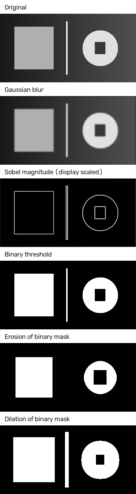

# BarePixel

A small image processing library i made using Python, NumPy and OpenCV.

I wanted to try implementing some image processing algorithms myself instead of just calling OpenCV functions for everything. Most of the calculations are done using NumPy and OpenCV is mainly used for loading and saving images.

Its still a small project and im learning more about how these algorithms work as i go.

## Features

- 2D convolution with custom kernels
- Gaussian blur and Sobel edge detection
- Image normalization and thresholding
- Erosion and dilation
- ImageTensor for working with image arrays
- Basic image processing pipelines
- PNG and JPEG support

## Results

Some examples of the filters and operations.



The results are generated using BarePixel. You can also generate them yourself with `python examples/generate_comparison.py`.

## Usage

```python
import numpy as np
import barepixel as bp

image = np.zeros((64, 64), dtype=np.uint8)
image[16:48, 16:48] = 255

pipeline = bp.Pipeline([bp.GaussianBlur(5), bp.Sobel(), bp.Normalize()])

result = pipeline.run(image)

bp.imwrite("output.png", np.rint(result * 255).astype(np.uint8))
```

## Installation

Requires Python 3.11 or newer.

Clone the repository and install it from the project folder.

```bash
pip install -e .
```

For development and testing:

```bash
pip install -e ".[dev]"
```

## How it works

Images are stored as NumPy arrays and the operations work directly on those arrays.

For example, convolution moves a kernel across an image and calculates the resulting pixel values. I implemented the basic convolution operation using NumPy, which is also used for some of the other filters.

The code is in `src/barepixel/` if you want to look through it.

## Testing

```bash
python -m pytest
```

There are also some examples in `examples/` and a convolution benchmark in `benchmarks/`.

## Notes

- This is mainly a learning project, not a replacement for OpenCV.
- No GPU acceleration or C++ backend.
- Image saving currently supports uint8 PNG/JPEG files.
- Morphological operations currently support grayscale images.

Might add more stuff later.

## License

MIT License.
made by mesh3al
